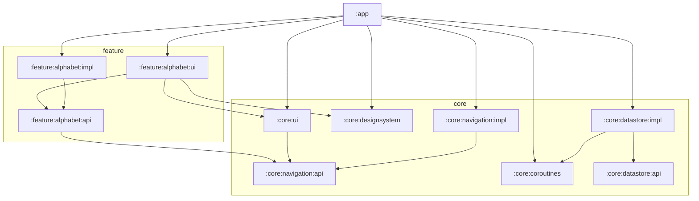

# Архитектура

Обзор для разработчиков: как устроена сборка, какие модули есть и как они зависят друг от друга, как работают MVI и навигация. Подробные чеклисты лежат в [CLAUDE.md](../CLAUDE.md).

## Сборка

- **Автоподключение модулей.** Плагин `IncludeSubdirsAsModulesPlugin` (`build-logic/settings`) обходит `core/` и `feature/` и подключает каждую папку с `build.gradle.kts`. Новый модуль достаточно создать на диске, `settings.gradle.kts` не трогать.
- **Convention-плагины** (`build-logic/convention`) хранят всю общую конфигурацию. В `build.gradle.kts` модуля остаются только `namespace` и собственные зависимости.

| Плагин | Что делает |
|---|---|
| `rmldev.android.application` | `:app`: SDK-версии, applicationId, версия |
| `rmldev.android.library` | Android-библиотека; префикс ресурсов из пути модуля (`feature_alphabet_ui_`) |
| `rmldev.kotlin.library` | чистый Kotlin/JVM-модуль |
| `rmldev.android.compose` | Compose + BOM + tooling |
| `rmldev.hilt` | KSP + Hilt (Android или core) |
| `rmldev.serialization` | kotlinx.serialization |
| `rmldev.coroutines` | зависимость на `:core:coroutines` |
| `rmldev.feature.api` | kotlin library + serialization + `api(:core:navigation:api)` |
| `rmldev.feature.impl` | kotlin library + Hilt |
| `rmldev.feature.ui` | android library + Compose + Hilt + `:core:ui`, `:core:designsystem`, Navigation 3 |

- **Версии** всех зависимостей лежат только в `gradle/libs.versions.toml`.

## Модули



### Правила зависимостей

- Фича — это `feature/<name>/{api,impl,ui,db}`.
  - `api` — контракт: UseCase-интерфейсы, модели, публичные NavKey. Чистый Kotlin.
  - `impl` — реализации и Hilt-биндинги. Зависит от `api` и `db`.
  - `ui` — экраны. Зависит **только** от `api`.
  - `db` — Room `@Entity`/`@Dao` фичи (пока ни в одной фиче не создан).
- Межфичевые зависимости — только на `:api` другой фичи.
- `:app` — единственный модуль, который видит все слои. Он собирает Hilt-граф и единую `RoomDatabase`.

## MVI

```
UI ─Intent─► StoreViewModel ─intentToAction─► Action ─► Actor ─event()──► Reducer ─► State ─► UiState ─► UI
                                                          └─sideEffect()─► Route (навигация, тосты)
```

| Часть | Роль |
|---|---|
| `Actor` | единственное место с корутинами и вызовами UseCase |
| `Reducer` | чистая функция `(State, Event) -> State` |
| `StateToUiMapper` | готовит `@Stable` UiState |
| `Screen` | stateless `(state, onIntent)` |
| `Route` | связывает ViewModel и Screen, собирает side effects |

Файлы экрана генерирует IDE-шаблон **MviStore** (`.idea/fileTemplates`, File → New → MviStore). Образец — `feature/alphabet/ui/.../grid/`.

## Навигация

Используется Navigation 3 со своим состоянием (`:core:navigation:impl`):

- **Табы.** У каждого `TabKey` свой бэкстек; стеки табов живут независимо.
- **Overlay** — отдельный стек поверх табов:
  - `ScreenOverlay.Modal` — табы видны под ним, back закрывает;
  - `ScreenOverlay.Blocking` — табы скрыты, back на корне закрывает приложение (например, онбординг).
- **Интерцепторы** (`NavigationInterceptor`) могут подменить или отменить любую команду до её выполнения: `Push`, `Replace`, `Back`, `PopWhere`, `TruncateEverywhere`, `Batch`.
- **Сохранение состояния.** Бэкстеки сохраняются через kotlinx.serialization с полиморфными ключами. Каждая фича регистрирует свои ключи Hilt-мультибиндингом `SerializersModuleBuilder.() -> Unit`, а экраны — мультибиндингом entry-билдеров. `MainActivity` собирает оба `Set`.

## Как добавить экран

1. Сгенерировать файлы шаблоном **MviStore** в `feature/<name>/ui/.../<screen>/`.
2. Объявить NavKey: `@Serializable`, `@SerialName("...")` (имя стабильное, не менять).
3. Добавить `entry<Key> { ... }` в `ui/navigation/EntryBuilder.kt` фичи.
4. Добавить `subclass(Key::class)` в `provideKeySerializerRegistrar` в `<Name>UiFeatureModule`. Если пропустить этот шаг, приложение упадёт не при переходе, а при сохранении состояния.
5. Проверить: открыть экран, повернуть устройство или включить «Don't keep activities», вернуться.

## Как добавить фичу

1. Создать `feature/<name>/{api,impl,ui}/build.gradle.kts` с плагинами `rmldev.feature.*` (по образцу `feature/alphabet`). Для Android-модулей указать `namespace`.
2. `api`: модели, UseCase-интерфейсы, публичные NavKey.
3. `impl`: реализации и Hilt-модуль с `@Binds`.
4. `ui`: экраны и `<Name>UiFeatureModule` с двумя мультибиндингами (entry-билдер и регистратор сериализаторов).
5. Подключить `impl` и `ui` (и `db`, если есть) в `app/build.gradle.kts`. Для таба — добавить пункт в `TOP_LEVEL_ITEMS`.

Подробные чеклисты (включая БД и миграции) — в [CLAUDE.md](../CLAUDE.md).
